# LR6

## Лабораторная работа №6

_Система контроля версий_

Преподаватель 
Ассиситент Рыжов К.Ю.

Работу выполнил 
Студент группы 4541в Вельков В.А.

_Цель лабораторной работы_: изучение базовых возможностей системы 
управления версиями, опыт работы с Git Api, опыт работы с локальным и 
удаленным репозиторием.

### Основная часть

1.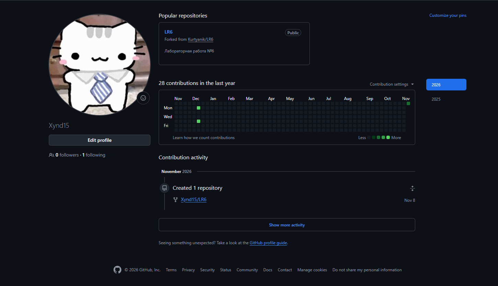

2.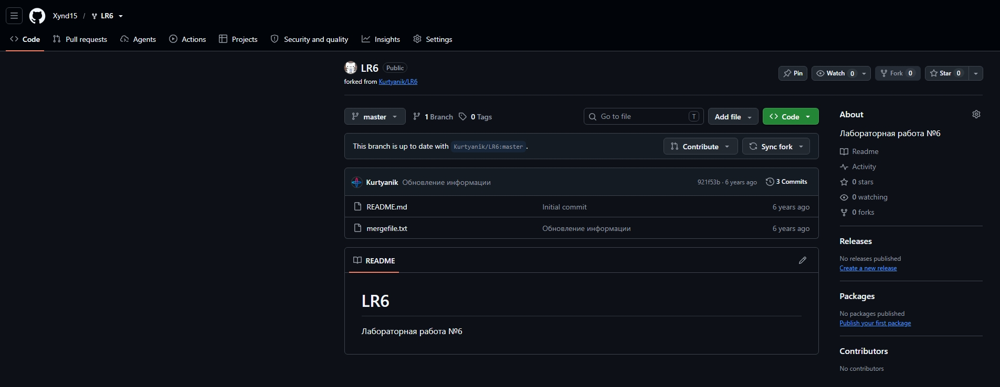

3.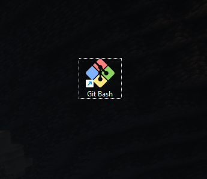

4.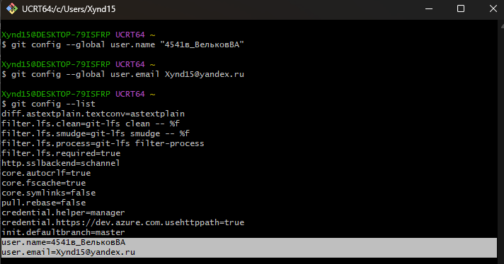

5.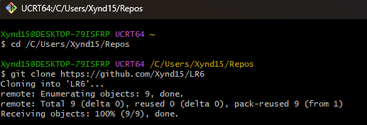

6.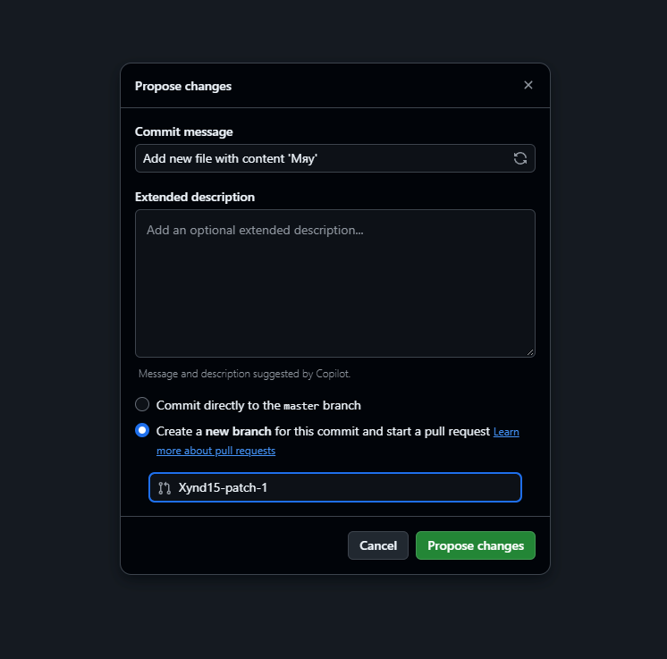

6.1.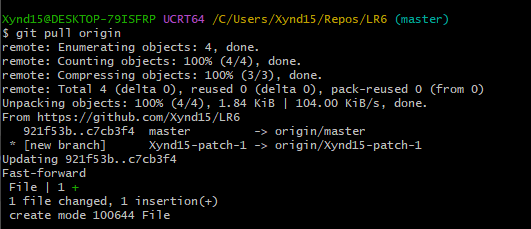

7.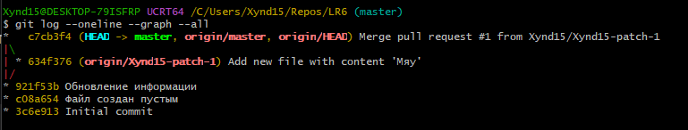

8.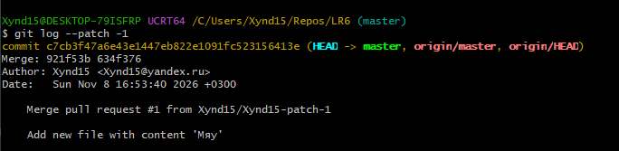

9.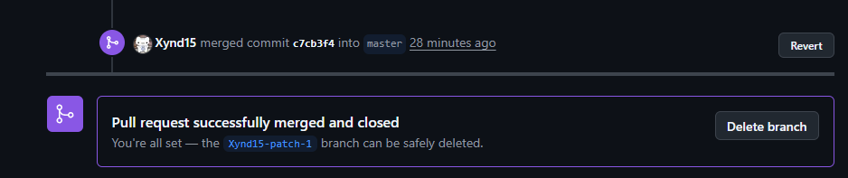

10.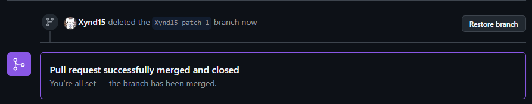

11.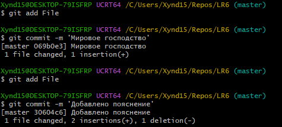

12.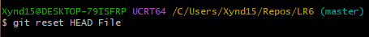

13.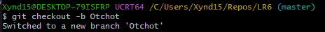

14.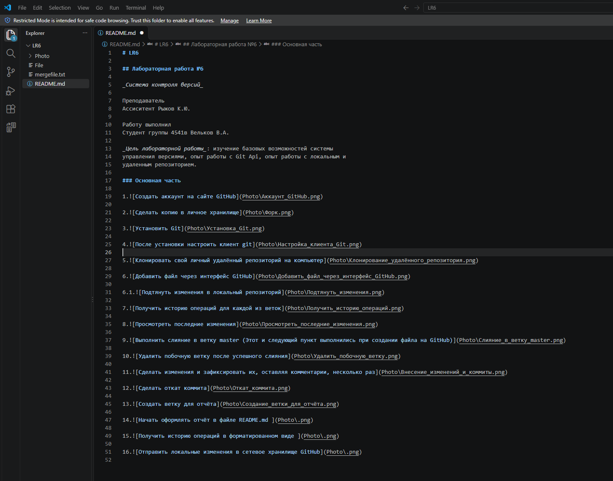

15.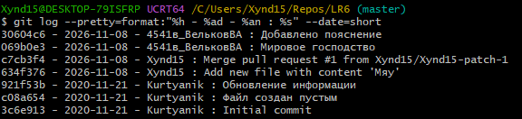

### Лог команд
```
git config --global user.name "4541в_ВельковВА"

git config --global user.email Xynd15@yandex.ru

git config --list

git clone https://github.com/Xynd15/LR6

git pull origin

git log --oneline --graph --all

git log --patch -1

git add File

git commit -m 'Мировое господство'

git commit -m 'Добавлено пояснение'

git reset HEAD File

git checkout -b Otchot

git log --pretty=format:"%h - %ad - %an : %s" --date=short

git push origin Otchot

git push origin master
```
